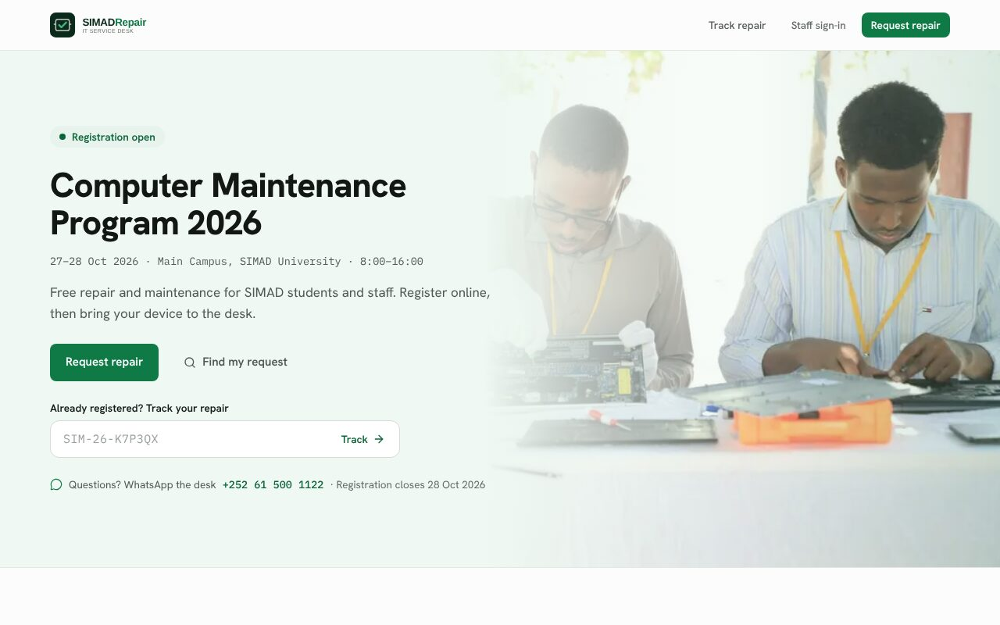
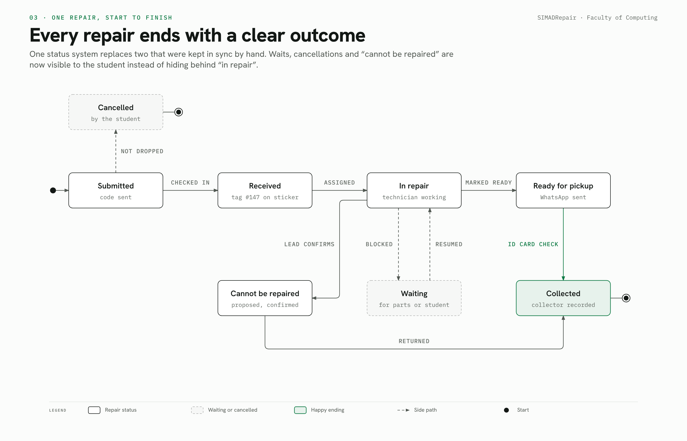
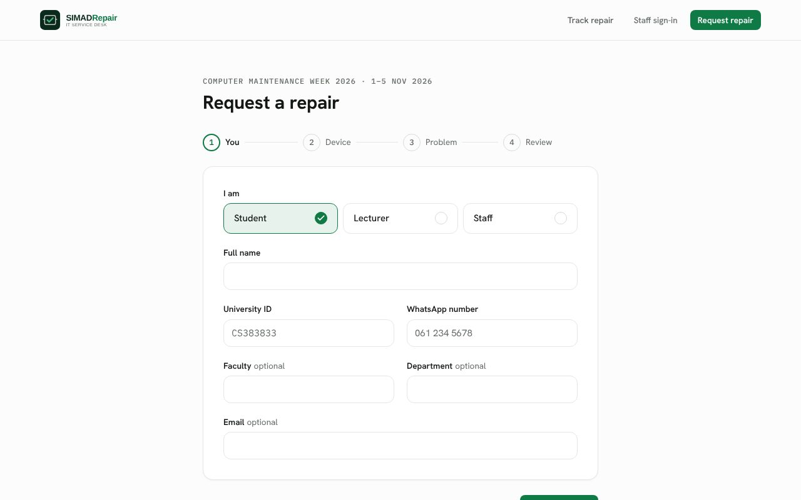
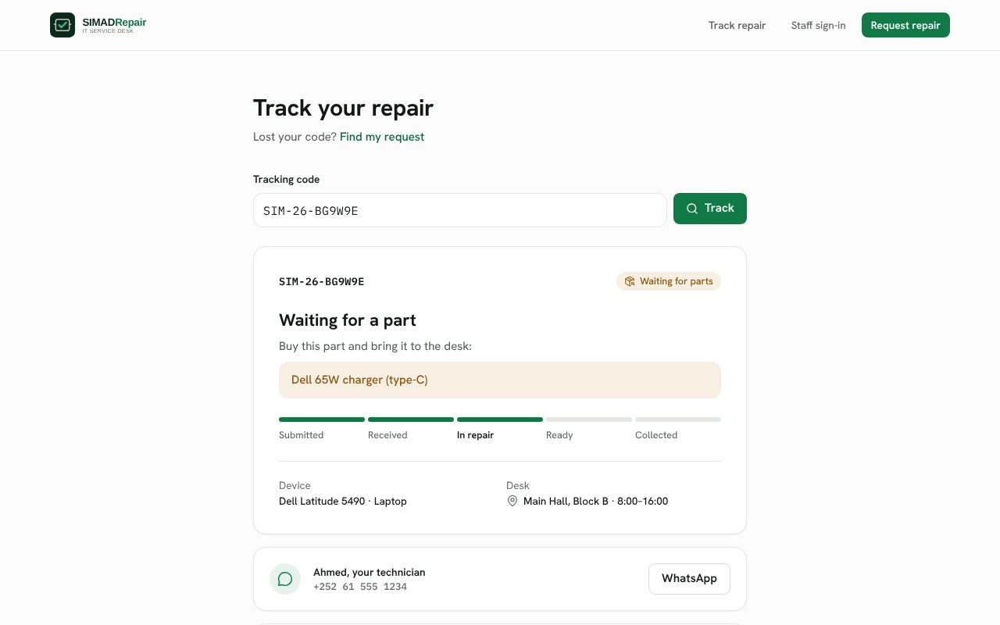
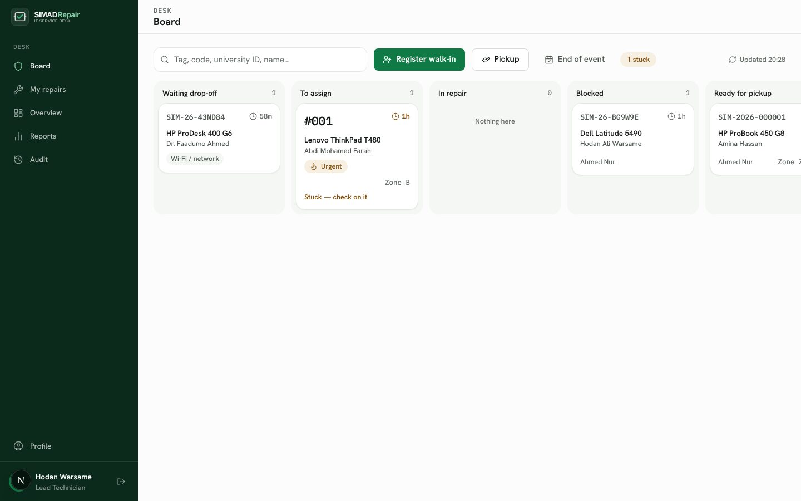
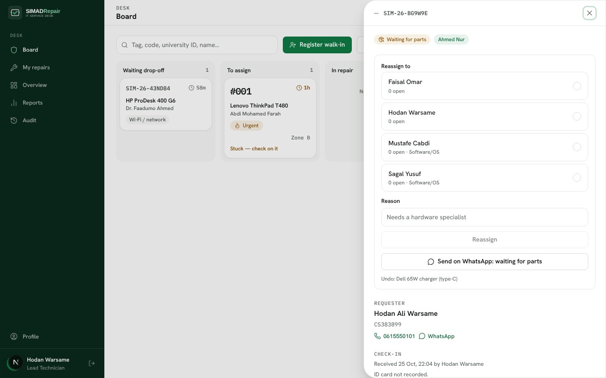
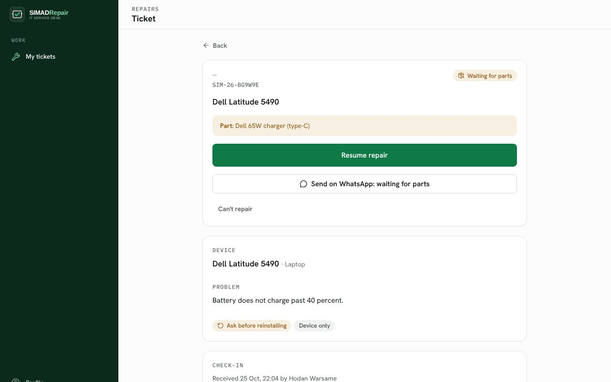
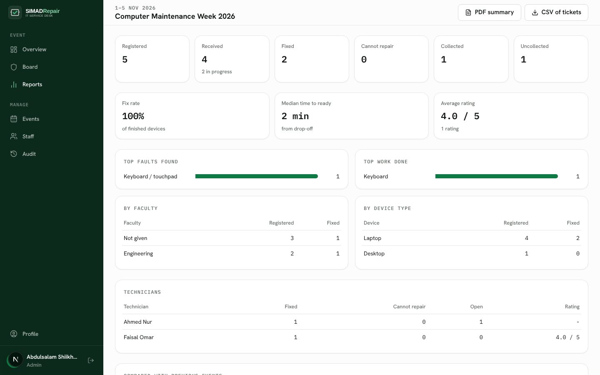

<div align="center">


### The IT service desk behind SIMAD University’s Computer Maintenance Program

Students register a laptop online, drop it off at the desk, follow the repair on their phone and collect it with their university ID card. Volunteer technicians repair, the lead desk keeps every device in view, and the university gets a report from real data after every event.

Built by the **Faculty of Computing Engineering Team**, SIMAD University.

[Leadership briefing (PDF)](docs/presentation/SIMADRepair-leadership-briefing.pdf) · [Diagrams](docs/diagrams) · [How it works, role by role](docs/platform/README.md) · [Spec](docs/platform/spec.md)



</div>

---

## Contents

- [What it does](#what-it-does)
- [How a repair moves](#how-a-repair-moves)
- [Screens](#screens)
- [Trust and privacy](#trust-and-privacy)
- [Tech stack](#tech-stack)
- [Getting started](#getting-started)
- [Configuration](#configuration)
- [Testing](#testing)
- [Deployment](#deployment)
- [Project structure](#project-structure)
- [Documentation](#documentation)
- [Team](#team)

## What it does

| Role | What they do in SIMADRepair |
| --- | --- |
| **Students and staff** (no account) | Register a device in four short steps (university ID, WhatsApp number, device specs, guided problem questions, up to 3 photos). Get a tracking code, follow the status, see what to bring if a part is needed, message their technician, cancel before drop-off, and rate the service. Lost the code? *Find my request* with university ID + last 4 phone digits. |
| **Lead technician** (the desk) | Live board of every device: *waiting drop-off → to assign → in repair → blocked → ready → collected*. About 30 seconds per check-in (ID card, condition, accessories, damage photos, tag sticker number), walk-in registration, assignment by workload and skills, stuck alerts, pickup against the owner’s ID card, undo with a reason, and end-of-event close-out. |
| **Volunteer technicians** | Phone-first workspace: claim up to 3 repairs, read the student’s intake and photos, mark *waiting for parts* or *action needed*, propose “cannot repair”, and record the fix (faults, work done, tests) before a device can be marked ready. |
| **Admin** | Events (dates, venue, hours, desk WhatsApp, hold days), staff and volunteer accounts with skills and access expiry, live overview, event report with one-page PDF and CSV export, and audit search across all events. |

**WhatsApp updates** at the key moments (received, waiting for a part, ready, reminders): staff tap one button and WhatsApp opens with the message already written in Somali and English. Every message sent is logged on the ticket.

## How a repair moves

One lifecycle for every ticket (see [ADR 0001](docs/adr/0001-single-ticket-lifecycle.md)). Every change goes through one workflow function and is written to the audit trail.



More diagrams, each role on its own page: [platform overview](docs/diagrams/png/01-platform-overview.png) · [end-to-end swimlane](docs/diagrams/png/02-end-to-end-swimlane.png) · [student journey](docs/diagrams/png/04-student-journey.png) · [lead desk](docs/diagrams/png/05-lead-desk.png) · [technician](docs/diagrams/png/06-technician-flow.png) · [admin event cycle](docs/diagrams/png/07-admin-event-cycle.png) · [before and after](docs/diagrams/png/08-before-after.png)

## Screens

| Request form | Tracking |
| --- | --- |
|  |  |
| **Lead desk board** | **Ticket sheet** |
|  |  |
| **Technician workspace** | **Event report** |
|  |  |

Screenshots show test data.

## Trust and privacy

- **Random tracking codes** (`SIM-26-K7P3QX`, no 0/O/1/I/L), so nothing can be guessed from someone else’s code.
- **Pickup against the owner’s university ID card**, with the collector’s name and phone recorded.
- **Device passwords encrypted** (AES-256-GCM) and deleted at pickup or when the event ends.
- **Private photos** in a private bucket, served only to signed-in staff.
- **Full audit trail**: every step records who, when and why, searchable by code, tag or university ID.
- **Data retention**: a daily job erases personal details 12 months after an event and keeps anonymous statistics.
- **Role-based access**: students need no account, staff see what their role needs, and volunteer access ends after the event.
- **Database-backed rate limits** on public forms, shared across server instances.

## Tech stack

| Layer | Choice |
| --- | --- |
| App | [Next.js 15](https://nextjs.org) (App Router), React 19, TypeScript |
| Data | PostgreSQL on [Supabase](https://supabase.com), [Prisma 5](https://www.prisma.io) |
| UI | Tailwind CSS with design tokens ([design system](docs/platform/design-system.md)), Hanken Grotesk + IBM Plex Mono, lucide icons |
| Validation | Zod, shared by API routes and forms |
| Auth | JWT in an HTTP-only cookie (`jose`), bcrypt password hashes |
| Files | Supabase Storage (private bucket); local `.data/photos` in development |
| Tests | Vitest (unit + database integration), Playwright + axe (end-to-end and accessibility) |
| Hosting | Vercel, with a daily cron job |

## Getting started

Requirements: Node.js 20+, a PostgreSQL database (local or Supabase).

```bash
git clone https://github.com/shimbirt-wq/simadrepair.git
cd simadrepair
cp .env.example .env          # fill in DATABASE_URL, DIRECT_URL and JWT_SECRET
npm install
npm run prisma:migrate        # create the schema
SEED_ADMIN_PASSWORD='choose-a-strong-one' npm run prisma:seed   # creates the first admin
npm run dev                   # http://localhost:3000
```

Sign in at `/auth/login` with the seeded admin, create the event under **Events**, add volunteers under **Staff**, and the public site opens registration on the event’s dates.

## Configuration

| Variable | Required | Purpose |
| --- | --- | --- |
| `DATABASE_URL` | yes | Pooled Postgres connection used by the app |
| `DIRECT_URL` | yes | Direct or session-pooler connection (port 5432) used for migrations |
| `JWT_SECRET` | yes | Signs staff sessions; use a long random value |
| `NEXT_PUBLIC_APP_URL` | production | Public address, used for links and the share image |
| `SUPABASE_URL`, `SUPABASE_SERVICE_ROLE_KEY`, `UPLOAD_BUCKET` | production | Private photo storage |
| `DEVICE_PASSWORD_KEY` | recommended | 32 random bytes (base64) to encrypt device passwords; otherwise derived from `JWT_SECRET` |
| `CRON_SECRET` | production | Protects the daily retention job |
| `SEED_ADMIN_PASSWORD` | seeding | Password for the first admin account |
| `TEST_DATABASE_URL` | tests | Separate database for integration tests; they are skipped without it |

See [`.env.example`](.env.example) for the full list with comments.

## Testing

```bash
npm run lint
npm run typecheck
npm test                    # unit + database integration tests (Vitest)
npm run test:db:prepare     # migrate the test database first
npm run test:e2e            # Playwright: public pages, staff sign-in, axe accessibility checks
```

Integration tests run against a real Postgres database (`TEST_DATABASE_URL`) and check behaviour through public interfaces: given a ticket and an action, what state and history result.

## Deployment

The app runs on **Vercel**.

- **Database migrations apply automatically** on production builds (`scripts/migrate-on-deploy.mjs`, before `next build`), so the live database always matches the code. This needs `DIRECT_URL` set in Vercel. With Supabase, use the **Session pooler** string (port 5432), because Vercel builds cannot reach the IPv6-only direct host. Preview builds skip this step.
- **Daily retention job**: `GET /api/cron/retention` (scheduled in [`vercel.json`](vercel.json)) with `Authorization: Bearer $CRON_SECRET`. It erases personal details 12 months after an event and clears unclaimed photo uploads and expired rate-limit counters. On other hosts, call it from any scheduler with the same header.

## Project structure

```
src/
  app/              routes: public pages, staff screens, API (app/api/**/route.ts)
  components/
    ui/             design-system components (Button, Field, Card, Badge, Dialog…)
    public/         website and requester screens
    staff/          lead desk board, ticket sheet, check-in, pickup, end of event
    technician/     technician workspace
  lib/              domain services (no HTTP)
    tickets/        workflow.ts decides every status change; ticket-service.ts persists it
    intake/ events/ board/ pickup/ messaging/ reports/ audit/ retention/ …
prisma/             schema, migrations, seed
e2e/                Playwright tests
docs/               platform docs, ADRs, diagrams, presentation, screenshots
```

## Documentation

| | |
| --- | --- |
| [Platform, role by role](docs/platform/README.md) | How each role works and the decisions behind it |
| [Spec](docs/platform/spec.md) | User stories and implementation decisions (GitHub issue #6, tickets #7–#32) |
| [Design system](docs/platform/design-system.md) · [UI principles](docs/platform/ui-principles.md) | Tokens, components and the rules for screens |
| [ADRs](docs/adr) | Architecture decisions |
| [Diagrams](docs/diagrams) | Overview, swimlane, lifecycle and one diagram per role (HTML + PNG) |
| [Leadership briefing](docs/presentation) | The 18-slide deck as PDF and images |

## Team

**Faculty of Computing Engineering Team, SIMAD University**

| | |
| --- | --- |
| Eng. Muscab Abdirashid | Team Lead Engineer |
| Eng. Ishak Abdiaziz | Full Stack Software Engineer |
| Eng. Ruweydo Hassan | Software Developer |
| Eng. Abdulsalam Hassan | Backend & AI Engineer |

The repairs themselves are done by Faculty of Computing student volunteers during the Computer Maintenance Program.
