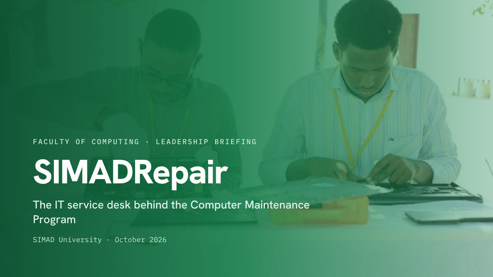

# Leadership briefing

The 18-slide deck presented to SIMAD University leadership before the Computer Maintenance Program 2026 (27–28 October, Main Campus).

- **[SIMADRepair-leadership-briefing.pdf](SIMADRepair-leadership-briefing.pdf)**: the whole deck, one slide per page (16:9)
- **[slides/](slides/)**: each slide as a 1920×1080 image, ready to drop into PowerPoint or Google Slides

| # | Slide | # | Slide |
| --- | --- | --- | --- |
| 01 | Cover | 10 | Technician flow |
| 02 | The program: dates, venue, five services | 11 | Every repair ends with a clear outcome |
| 03 | Five problems the platform removes | 12 | Event report and admin tools |
| 04 | Platform overview | 13 | One event, from setup to report |
| 05 | Who does what, from registration to report | 14 | Trust and privacy |
| 06 | Students: home and tracking screens | 15 | “Every repair leaves a record” |
| 07 | Student journey | 16 | Ready for 27–28 October |
| 08 | Lead desk: the live board | 17 | The Faculty of Computing Engineering Team |
| 09 | Lead desk flow | 18 | Thank you |

The diagrams on slides 3–5, 7, 9–11 and 13 are generated from [`docs/diagrams/source`](../diagrams/source). Screenshots show test data, not results from a real program.

